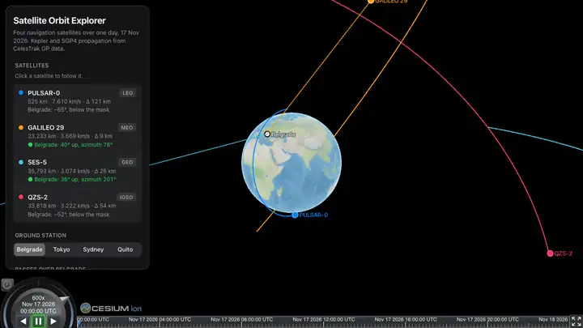
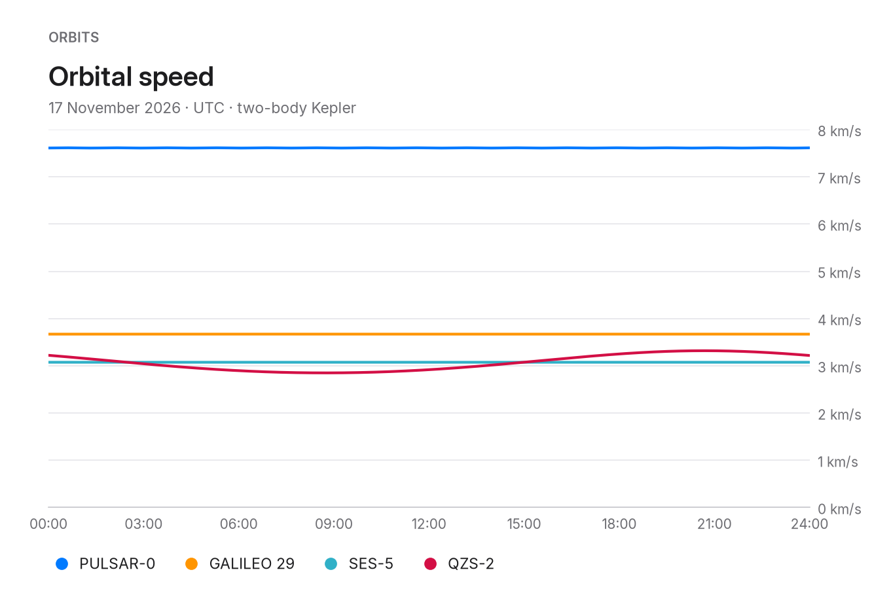
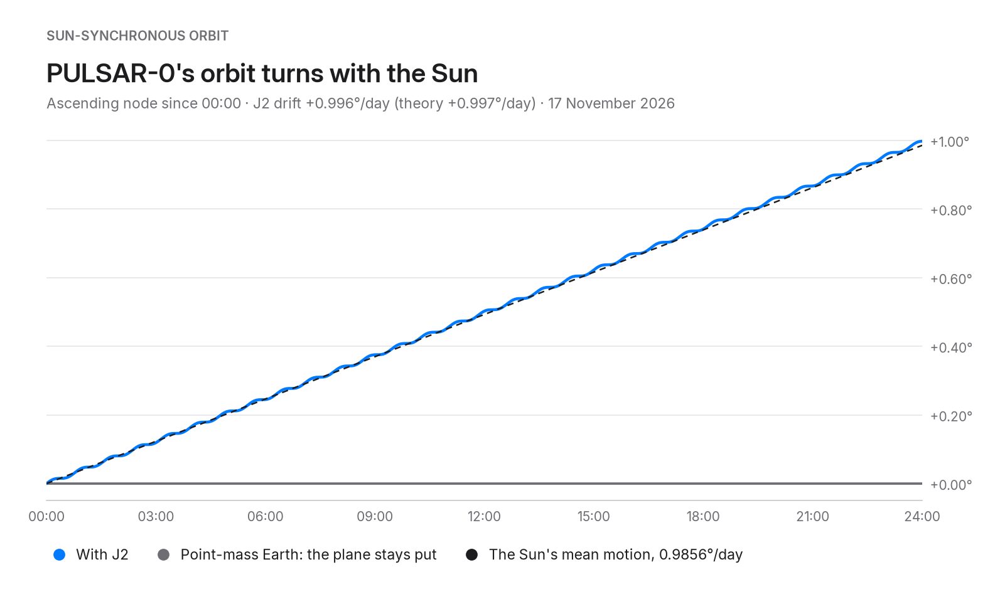

# Satellite Orbit Explorer

Orbit propagation in Python for four real navigation satellites (LEO, MEO,
GEO and IGSO), from CelesTrak's public GP (General Perturbations) element
sets, the ones SGP4 uses. It goes from Kepler's two-body model to a numerical
propagator with Earth's oblateness, the Moon and the Sun, and validates every
step against precise GNSS orbits.

**[Open the 3D viewer](https://devojka-od-papira.github.io/satellite-orbit-explorer/)**:
the satellites on a globe over one day, with Kepler and SGP4 side by side,
and the passes over a ground station.

## Result
Distance from GFZ's precise orbits (SP3, accurate to centimetres), RMS over
2026-11-17:

| Model | Started from | GALILEO 29 (MEO) | QZS-2 (IGSO) |
|---|---|---|---|
| Kepler | GP elements | 20.5 km | 36.1 km |
| SGP4 | GP elements | 0.75 km | 4.4 km |
| Own propagator: J2 + Moon + Sun | SGP4's state at 00:00 | 0.86 km | 2.5 km |
| Own propagator: J2 | the precise orbit at 00:00 | 1.5 km | 3.3 km |
| Own propagator: J2 + Moon + Sun | the precise orbit at 00:00 | **0.14 km** | **0.36 km** |

- **From the same start as SGP4**, the full force model is in SGP4's league:
  a bit behind for GALILEO 29 and nearly twice as good for QZS-2. Both carry
  the GP elements' initial error: at 00:00 already 0.36 km (GALILEO 29) and
  4.3 km (QZS-2).
- **From the precise orbit**, the same model drifts only 0.14 km in a day.
  The Moon and the Sun account for about 90% of the J2-only error. So a good
  starting state (orbit determination) matters more than the force model.
- **What remains is about the size of solar radiation pressure.** This is an
  estimate (about 0.4 km/day), not yet a model.

## What's inside
- **Orbit models**
  - Kepler's equation (Newton-Raphson).
  - SGP4/SDP4.
  - A numerical RK4 propagator: point mass, J2, and Moon and Sun as third
    bodies. Batched over satellites.
- **Precise orbits**
  - An SP3-c/d reader and writer.
  - Degree-10 Lagrange interpolation: 3–8 mm when every other epoch is left out.
  - Satellites matched by position, because SP3 names them by PRN, not NORAD ID.
- **Frames and time**
  - TEME to ITRF with IAU-82 GMST at UT1, plus polar motion from IERS data.
  - GPS time and TT to UTC, from one leap-second table that refuses dates it
    wasn't checked for.
  - ECEF to geodetic on WGS84.
- **Ephemerides**
  - Sun (Meeus) and Moon (Montenbruck & Gill).
  - Checked against the 2026 equinoxes, solstices and lunar phases.
- **Ground stations**
  - Look angles and passes above an elevation mask, with sky plots.
  - Four stations: Belgrade, Tokyo, Sydney, Quito.
- **Engineering**
  - Tests that check the physics, not only the numbers: energy conservation,
    the exact circular orbit, J2 secular theory, tidal geometry.
  - CI on Python 3.11–3.14, plus browser tests of the 3D viewer.
  - Daily data refresh through pull requests.

## Step by step
### 1. Kepler's two-body model
[`kepler.py`](src/orbit_explorer/kepler.py) reads GP (OMM) elements from
CelesTrak and propagates each orbit over one day at a 5 s step.
[`frames.py`](src/orbit_explorer/frames.py) turns positions Earth-fixed and
geodetic on WGS84, for ground tracks, KML and the 3D viewer.

All periods, perigee/apogee altitudes and speed ranges matched the GNSS Academy
workshop reference values. That dataset (2026-11-10) is kept in `tests/data/`.

PULSAR-0 in low orbit is the fastest, at about 7.6 km/s. GALILEO 29 moves at
about 3.7 km/s and SES-5 at about 3.1 km/s. Their orbits are close to circular,
so their speed barely changes. QZS-2 has the same 24-hour period as SES-5, but
its orbit is eccentric (e ≈ 0.076), so its speed swings by about 0.5 km/s over
the day.

### 2. Kepler vs SGP4
GP elements are meant for SGP4, which adds Earth's oblateness (J2–J4), drag and,
for high orbits, lunar and solar gravity
([`sgp4_compare.py`](src/orbit_explorer/sgp4_compare.py), GP data of
2026-11-17):

- **At each satellite's GP epoch** the two models differ by 8–32 km. GP
  elements are SGP4 *mean* elements, not osculating Keplerian ones.
- **LEO (PULSAR-0)** drifts apart fastest: about 340 km by the end of the day,
  mostly in-track.
- **MEO, GEO and IGSO** stay within about 30–55 km all day.
- **Element age matters as much as the model.** With a QZS-2 record 23 days
  old the difference was about 200 km from the start of the day.

### 3. Earth's oblateness: a J2 propagator
[`j2.py`](src/orbit_explorer/j2.py) integrates the equations of motion with
classic fourth-order Runge-Kutta (5 s step): point-mass gravity plus J2, the
largest term of the equatorial bulge. Two-body and J2 runs both start from
SGP4's state at 00:00, so their distance from SGP4 shows only what each force
model leaves out:

- **PULSAR-0 (LEO): J2 is almost everything.** A point-mass Earth is about
  2,200 km away from SGP4 after a day; with J2 it stays within about 3 km.
- **Why a point mass started from the true state is worse than Kepler from
  the GP elements:** the instantaneous orbit at 00:00 includes J2's
  short-period wobble. Its semi-major axis is 12 km short of the mean one, so
  its period is 15 s too short, and that adds up every orbit. This is why GP
  elements are *mean* elements.
- **PULSAR-0 is sun-synchronous.** J2 turns its orbital plane by +0.996° a day,
  within 0.1% of first-order theory and 1% of the Sun's 0.986° a day.
- **Constants.** The propagator uses WGS84; SGP4 uses the older WGS72. The
  summary shows both: the constants alone move the result by up to ~1 km.

### 4. Validation against precise orbits
[`validation.py`](src/orbit_explorer/validation.py) compares every model with
the truth: GFZ's rapid multi-GNSS orbits for the two satellites that have
them, GALILEO 29 (`E29`) and QZS-2 (`J02`). It uses 2026-11-17, with the GP
elements of that same day. `data/inputs/precise/manifest.json` is the one
description of that day: the SP3 file, the GP data and the Earth orientation.
The table and figure are at the top.

- **SGP4 does what it was made for:** under a kilometre for GALILEO 29.
- **J2 started on SGP4** inherits SGP4's starting error and adds no accuracy.
  At these altitudes the Moon and the Sun matter more than the bulge. With them
  added, the model from the same start is in SGP4's league: 0.86 km for
  GALILEO 29 (SGP4 0.75) and 2.5 km for QZS-2 (SGP4 4.4).
- **J2 started on the truth** leaves only the force model's error. It stays
  within 100 m for the first hour and reaches 3–5 km by the end of the day,
  mostly in-track.
- **The Moon and the Sun are about 90% of that.**
  [`ephemeris.py`](src/orbit_explorer/ephemeris.py) adds them as point masses
  (the Sun from Meeus, the Moon from Montenbruck & Gill). The error falls about
  ten times. At Galileo's altitude the Moon pulls about 2.5 times as hard as the
  Sun (5.8e-9 vs 2.3e-9 km/s²).
- **What is left is the size of solar radiation pressure.** This is an
  estimate, not a model. A Galileo satellite has about 0.02 m² of sunlit area
  per kg, so sunlight pushes it with about 1.2e-10 km/s². Unmodelled, that is
  worth up to about 0.4 km in a day. The J3 harmonic is at most about
  5e-11 km/s² (up to 0.17 km, mostly periodic).
- **Frames and time.** SP3 positions are Earth-fixed (IGc20) and in GPS time.
  The comparison converts GPS time to UTC (18 s), rotates by sidereal time at
  UT1, and applies polar motion. It uses the IERS values for the day:
  UT1−UTC = −0.072 s, pole at 0.12″ and 0.33″. Leaving those out would move the
  result by 0.16–0.23 km. Reading GPS time as UTC would move it by about 50 km
  (GALILEO 29) and 25 km (QZS-2).
- **The SP3 reader** ([`sp3.py`](src/orbit_explorer/sp3.py)) interpolates
  with a degree-10 Lagrange polynomial. Dropping every other epoch and
  interpolating it back recovers it to 3 mm (E29) and 8 mm (J02). To make
  the stored subset from a downloaded file:

      python -m orbit_explorer.sp3 GBM0MGXRAP_20263210000_01D_05M_ORB.SP3.gz --keep E29 J02 -o data/inputs/precise/GBM0MGXRAP_20263210000_01D_05M_ORB_E29_J02.sp3

### 5. Visibility from a ground station
[`visibility.py`](src/orbit_explorer/visibility.py) turns SGP4 positions into
azimuth, elevation and range for a station. It lists the passes above a 10°
elevation mask, and how far Kepler shifts each rise and set. From Belgrade
on 2026-11-17:

- **SES-5** sits still at 36° elevation, azimuth 201° (south, a little west).
- **PULSAR-0** makes 4 passes, each 3–7 minutes long. Kepler gets rise and set
  wrong by up to about 40 s.
- **GALILEO 29** makes two long passes of about 2.5 and 1.7 hours.
- **QZS-2** never rises more than 1° above the horizon. QZSS is a regional
  system for Asia-Oceania.

`--station tokyo` (or `sydney`, `quito`) runs the same analysis for the 3D
viewer's other stations. From Tokyo, QZS-2 traces its figure eight high in
the southern sky. It stays above 10° in one pass of about 19 hours:

### 6. 3D viewer
A static CesiumJS page in `web/` that loads `orbits.czml`
([`czml.py`](src/orbit_explorer/czml.py)). It shows the satellites over the
day, in the Earth-fixed or inertial frame, with Kepler and SGP4 side by side.
For the chosen ground station it adds:
- live elevation and azimuth;
- the day's passes, where a click jumps to the pass (short LEO passes play at
  30×);
- a line to each satellite while it is above the mask;
- for PULSAR-0, its visibility circle on the ground.

A link ending in `#tokyo`, `#sydney` or `#quito` opens on that station. The
interface follows Apple's dark design, to match the figures.

## Run it
    pip install -e .
    python -m orbit_explorer.report
    python -m orbit_explorer.plots
    python -m orbit_explorer.kml
    python -m orbit_explorer.czml
    python -m orbit_explorer.sgp4_compare
    python -m orbit_explorer.j2
    python -m orbit_explorer.validation
    python -m orbit_explorer.visibility    # Belgrade
    python -m orbit_explorer.visibility --station tokyo    # or sydney, quito
    python -m orbit_explorer.visibility --name "Novi Sad" --lat 45.25 --lon 19.84 --height 80

To preview the 3D viewer locally (GitHub Actions publishes it to GitHub Pages
on every push to `main`):

    python -m orbit_explorer.czml
    mkdir -p _site && cp -R web/. _site/ && cp outputs/orbits.czml _site/
    python -m http.server 8000 -d _site    # then open http://localhost:8000

## Data and daily refresh
`data/inputs/orbital_elements.json` holds the GP records and
`data/inputs/data_manifest.json` records where and when they were downloaded.
The propagation window starts at midnight UTC of the download day. To refresh
from CelesTrak:

    python -m orbit_explorer.fetch

This rewrites both files only if every download succeeds. It warns when an
epoch is more than 3 days from the window start. CelesTrak asks for no more
than one download of the same data every two hours, so the script refuses to
download again within 2 hours (`--force` overrides).

A GitHub Actions workflow (`.github/workflows/refresh.yml`) does this every
day. It runs the tests on the new data, then opens a pull request (or updates
the open one) titled "Refresh GP data from CelesTrak (date)". The PR
description lists that day's model differences and passes over Belgrade.
Merging it publishes the 3D viewer for the new day. The figures and numbers in
this README stay at their documented date.

- **Needs a repository setting.** To let the workflow open PRs, turn on "Allow
  GitHub Actions to create and approve pull requests" under Settings → Actions
  → General.
- **Stale data is flagged.** If an element set is more than 3 days from the
  window start, the PR title ends in "stale elements" and the description
  starts with a warning.
- **Your commits are safe.** If the open refresh PR has commits that the
  workflow did not make, it skips that day and leaves a comment instead of
  force-pushing over them. The push uses `--force-with-lease`.
- **Rate limit.** It counts a download on an unmerged refresh branch too.
- **Local preview.** `DRY_RUN=1 .github/scripts/daily_refresh.sh` previews the
  PR, then puts the data back.

## Development
    pip install -e ".[dev]"
    pre-commit install
    pytest

Most tests run on the current GP data, which the daily refresh replaces, so
they only check what must hold for any day's data. Tests about what one day
shows use a frozen copy of the 2026-11-17 data in `data/inputs/precise/`, so a
new day can't break them. Examples: how much J2 helps each satellite, and
agreement with that day's precise orbits.

The 3D viewer has its own tests in `tests/viewer`. They build the site, open
it in headless Chromium with Playwright, and check the panel, the station
picker, the passes and the live look angles against the Python results. CI
runs them in a separate job. Locally:

    pip install -e ".[viewer]"
    playwright install chromium    # or skip it to use an installed Google Chrome
    pytest tests/viewer

Without Playwright, `pytest` skips them.

The animation at the top is recorded the same way, by stepping the viewer's
clock through four hours in headless Chromium:

    python tools/record_viewer.py    # docs/images/viewer.webp (about 400 KB)

## Style
All figures share one look, set in [`style.py`](src/orbit_explorer/style.py)
after Apple's chart design: system colours, light gridlines, no frames, and a
left-aligned header. Each satellite keeps its colour in every figure, in Google
Earth and in the 3D viewer, and the four colours stay distinguishable with
colour blindness. The typeface is [Inter](https://github.com/rsms/inter),
bundled under the SIL Open Font License.

Built during GNSS Academy's Space Career Week 2026.
