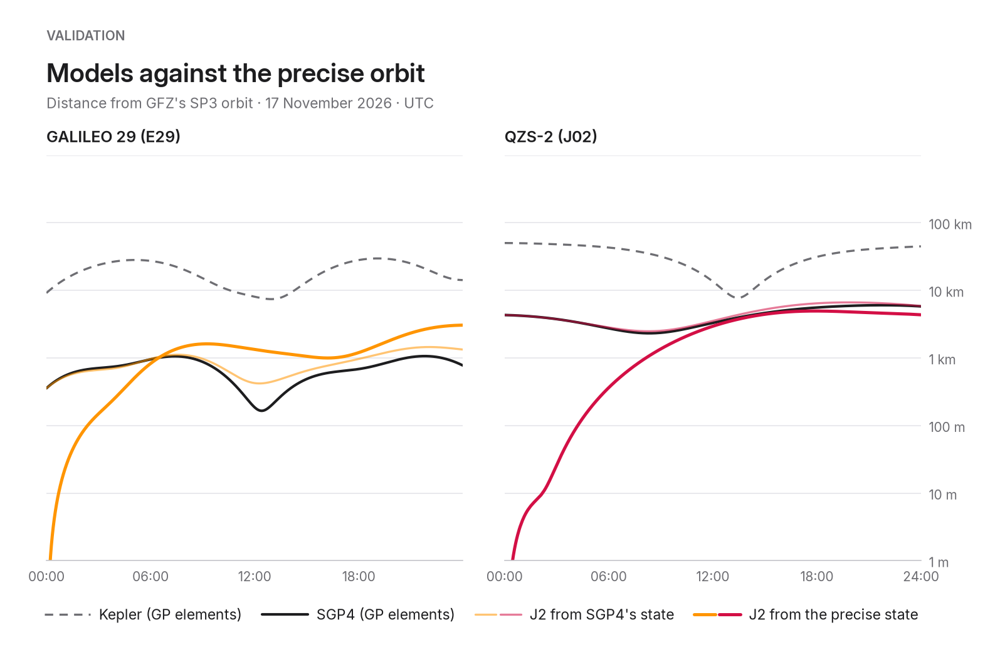
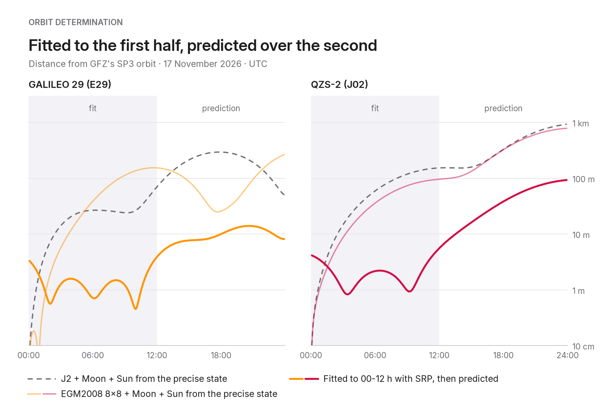
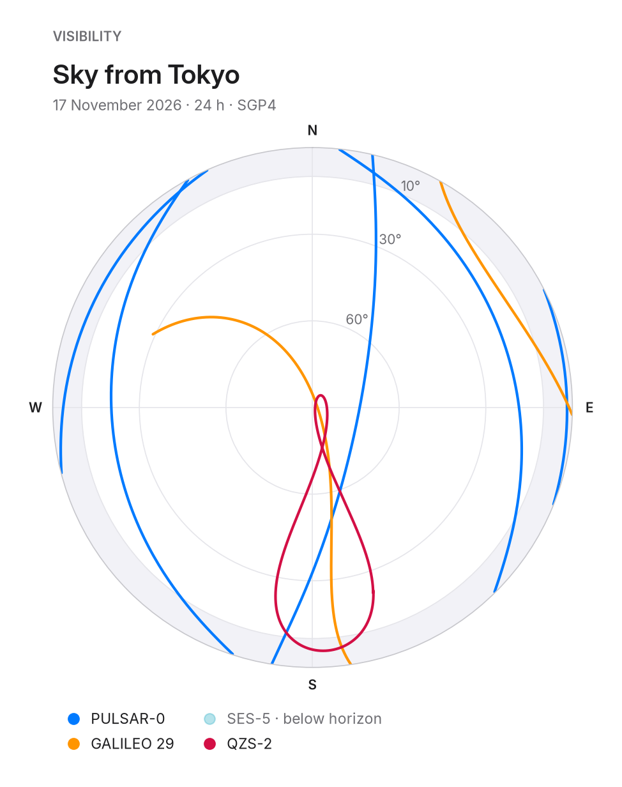
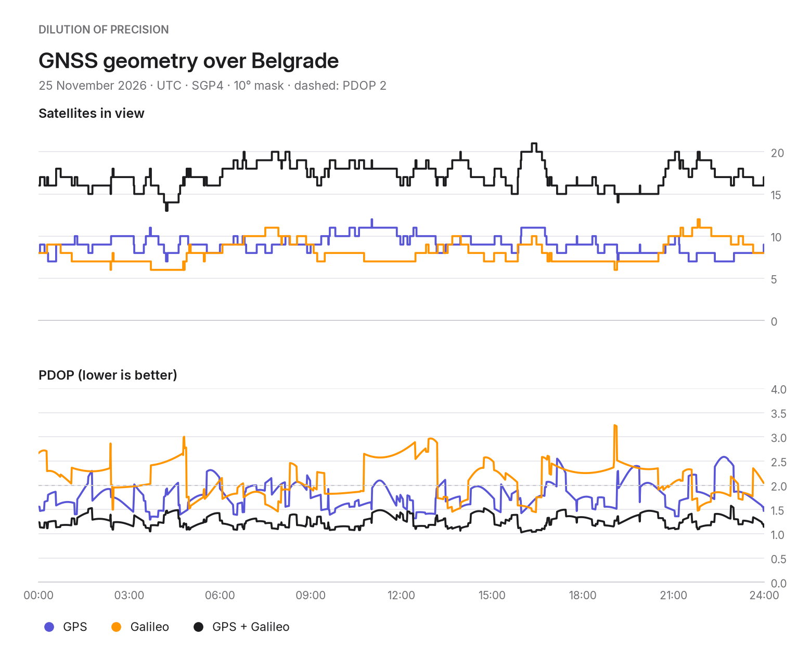
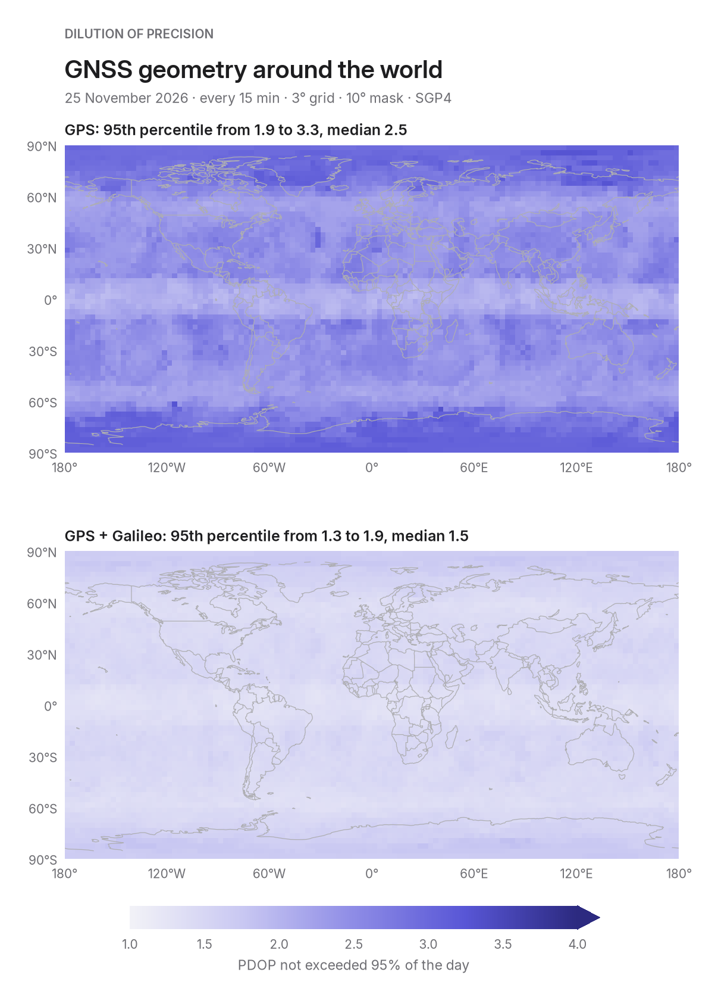

# Satellite Orbit Explorer

Orbit propagation in Python for four real navigation satellites (LEO, MEO,
GEO and IGSO), from CelesTrak's public GP (General Perturbations) element
sets, the ones SGP4 uses. It goes from Kepler's two-body model to a numerical
propagator with Earth's gravity field, the Moon and the Sun, validates every
step against precise GNSS orbits, and ends with orbit determination: a fit
that learns the solar radiation pressure from the precise orbit and predicts
ahead.

**At a glance**
- **Orbit determination:** batch least squares with EGM2008 gravity and
  solar radiation pressure. Fitted to 12 hours of precise orbit, it predicts
  the next 12 within 10 m RMS (GALILEO 29) and 52 m (QZS-2)
  ([section 5](#5-orbit-determination-fitting-the-push-of-sunlight)).
- **Validated against the truth:** every model is compared with GFZ's precise
  GNSS orbits (SP3), through TEME → ITRF with UT1 and polar motion from IERS
  ([section 4](#4-validation-against-precise-orbits)).
- **GNSS geometry:** DOP for all of GPS and Galileo; using both systems cuts
  PDOP over Belgrade by 30% ([section 7](#7-gnss-geometry-dilution-of-precision)).
- **Engineering:** about 400 tests that check the physics (closed forms,
  conservation laws, recovery of known solutions), CI on Python 3.11–3.14,
  browser tests of the 3D viewer, and an automated data refresh through pull
  requests.

**[Open the 3D viewer](https://devojka-od-papira.github.io/satellite-orbit-explorer/)**:
the satellites on a globe over one day, with Kepler and SGP4 side by side,
and the passes over a ground station. **[Or see them live](https://devojka-od-papira.github.io/satellite-orbit-explorer/?now)**:
SGP4 running in the browser, with the next pass over the station.

## Result
Distance from GFZ's precise orbits (SP3, accurate to centimetres), RMS over
2026-11-17:

| Model | Started from | GALILEO 29 (MEO) | QZS-2 (IGSO) |
|---|---|---|---|
| Kepler | GP elements | 20.5 km | 36.1 km |
| SGP4 | GP elements | 0.75 km | 4.4 km |
| Own propagator: J2 + Moon + Sun | SGP4's state at 00:00 | 0.86 km | 2.5 km |
| Own propagator: J2 | the precise orbit at 00:00 | 1.5 km | 3.3 km |
| Own propagator: J2 + Moon + Sun | the precise orbit at 00:00 | **0.14 km** | **0.36 km** |
| Orbit determination: EGM2008 + Moon + Sun + SRP | fitted to 00–12 h; RMS of the 12–24 h prediction¹ | **0.010 km** | **0.052 km** |

¹ A different window from the rows above (the whole day). Over the same
12–24 h, J2 + Moon + Sun from the precise orbit is 0.21 km (GALILEO 29) and
0.50 km (QZS-2).

- **From the same start as SGP4**, the full force model is in SGP4's league:
  a bit behind for GALILEO 29 and nearly twice as good for QZS-2. Both carry
  the GP elements' initial error: at 00:00 already 0.36 km (GALILEO 29) and
  4.3 km (QZS-2).
- **From the precise orbit**, the same model drifts only 0.14 km in a day.
  The Moon and the Sun account for about 90% of the J2-only error. So a good
  starting state (orbit determination) matters more than the force model.
- **Orbit determination closes most of the rest.** With the gravity field
  beyond J2 and a fitted solar radiation pressure, a fit to the first 12
  hours predicts the next 12 within 10 m RMS for GALILEO 29 and 52 m for
  QZS-2, where J2 + Moon + Sun from the precise orbit is 210 m and 502 m
  over the same 12 hours
  ([section 5](#5-orbit-determination-fitting-the-push-of-sunlight)).

## What's inside
- **Orbit models**
  - Kepler's equation (Newton-Raphson).
  - SGP4/SDP4.
  - A numerical RK4 propagator: point mass, J2, and Moon and Sun as third
    bodies. Batched over satellites.
  - EGM2008 gravity field to degree 12 and solar radiation pressure
    (cannonball and DYB, with the Earth's shadow).
- **Orbit determination**
  - Batch least squares for the state and SRP parameters, from precise
    positions; scored on a prediction the fit never saw.
- **Precise orbits**
  - An SP3-c/d reader and writer.
  - Degree-10 Lagrange interpolation: 3–8 mm when every other epoch is left out.
  - Satellites matched by position, because SP3 names them by PRN, not NORAD ID.
- **Frames and time**
  - TEME to ITRF with IAU-82 GMST at UT1, plus polar motion from IERS data.
  - GPS time and TT to UTC, from one leap-second table that refuses dates it
    wasn't checked for.
  - ECEF to geodetic on WGS84.
- **Ephemerides**
  - Sun (Meeus) and Moon (Montenbruck & Gill).
  - Checked against the 2026 equinoxes, solstices and lunar phases.
- **Ground stations**
  - Look angles and passes above an elevation mask, with sky plots.
  - Four stations: Belgrade, Tokyo, Sydney, Quito.
- **GNSS geometry**
  - DOP (GDOP, PDOP, HDOP, VDOP) for all of GPS and Galileo, alone and
    together, with one clock offset per system.
  - Over the day at a station, and a world map.
- **Engineering**
  - Tests that check the physics, not only the numbers: energy conservation,
    the exact circular orbit, J2 secular theory, tidal geometry.
  - CI on Python 3.11–3.14, plus browser tests of the 3D viewer.
  - Data refresh every 6 hours through pull requests, with an archive of every
    element set downloaded.
  - Supply chain: CI with a read-only token, `pip-audit` against known
    vulnerabilities, and Dependabot for package and Actions updates.

## Step by step
### 1. Kepler's two-body model
[`kepler.py`](src/orbit_explorer/kepler.py) reads GP (OMM) elements from
CelesTrak and propagates each orbit over one day at a 5 s step.
[`frames.py`](src/orbit_explorer/frames.py) turns positions Earth-fixed and
geodetic on WGS84, for ground tracks, KML and the 3D viewer.

All periods, perigee/apogee altitudes and speed ranges matched the GNSS Academy
workshop reference values. That dataset (2026-11-10) is kept in `tests/data/`.

PULSAR-0 in low orbit is the fastest, at about 7.6 km/s. GALILEO 29 moves at
about 3.7 km/s and SES-5 at about 3.1 km/s. Their orbits are close to circular,
so their speed barely changes. QZS-2 has the same 24-hour period as SES-5, but
its orbit is eccentric (e ≈ 0.076), so its speed swings by about 0.5 km/s over
the day.

### 2. Kepler vs SGP4
GP elements are meant for SGP4, which adds Earth's oblateness (J2–J4), drag and,
for high orbits, lunar and solar gravity
([`sgp4_compare.py`](src/orbit_explorer/sgp4_compare.py), GP data of
2026-11-17):

- **At each satellite's GP epoch** the two models differ by 8–32 km. GP
  elements are SGP4 *mean* elements, not osculating Keplerian ones.
- **LEO (PULSAR-0)** drifts apart fastest: about 340 km by the end of the day,
  mostly in-track.
- **MEO, GEO and IGSO** stay within about 30–55 km all day.
- **Element age matters as much as the model.** With a QZS-2 record 23 days
  old the difference was about 200 km from the start of the day.

### 3. Earth's oblateness: a J2 propagator
[`j2.py`](src/orbit_explorer/j2.py) integrates the equations of motion with
classic fourth-order Runge-Kutta (5 s step): point-mass gravity plus J2, the
largest term of the equatorial bulge. Two-body and J2 runs both start from
SGP4's state at 00:00, so their distance from SGP4 shows only what each force
model leaves out:

- **PULSAR-0 (LEO): J2 is almost everything.** A point-mass Earth is about
  2,200 km away from SGP4 after a day; with J2 it stays within about 3 km.
- **Why a point mass started from the true state is worse than Kepler from
  the GP elements:** the instantaneous orbit at 00:00 includes J2's
  short-period wobble. Its semi-major axis is 12 km short of the mean one, so
  its period is 15 s too short, and that adds up every orbit. This is why GP
  elements are *mean* elements.
- **PULSAR-0 is sun-synchronous.** J2 turns its orbital plane by +0.996° a day,
  within 0.1% of first-order theory and 1% of the Sun's 0.986° a day.
- **Constants.** The propagator uses WGS84; SGP4 uses the older WGS72. The
  summary shows both: the constants alone move the result by up to ~1 km.

### 4. Validation against precise orbits
[`validation.py`](src/orbit_explorer/validation.py) compares every model with
the truth: GFZ's rapid multi-GNSS orbits for the two satellites that have
them, GALILEO 29 (`E29`) and QZS-2 (`J02`). It uses 2026-11-17, with the GP
elements of that same day. `data/inputs/precise/manifest.json` is the one
description of that day: the SP3 file, the GP data and the Earth orientation.
The table and figure are at the top.

- **SGP4 does what it was made for:** under a kilometre for GALILEO 29.
- **J2 started on SGP4** inherits SGP4's starting error and adds no accuracy.
  At these altitudes the Moon and the Sun matter more than the bulge. With them
  added, the model from the same start is in SGP4's league: 0.86 km for
  GALILEO 29 (SGP4 0.75) and 2.5 km for QZS-2 (SGP4 4.4).
- **J2 started on the truth** leaves only the force model's error. It stays
  within 100 m for the first hour and reaches 3–5 km by the end of the day,
  mostly in-track.
- **The Moon and the Sun are about 90% of that.**
  [`ephemeris.py`](src/orbit_explorer/ephemeris.py) adds them as point masses
  (the Sun from Meeus, the Moon from Montenbruck & Gill). The error falls about
  ten times. At Galileo's altitude the Moon pulls about 2.5 times as hard as the
  Sun (5.8e-9 vs 2.3e-9 km/s²).
- **What is left is two forces of the same size.** A Galileo satellite has
  about 0.02 m² of sunlit area per kg, so sunlight pushes it with about
  1.2e-10 km/s², worth up to about 0.4 km in a day. The gravity field beyond
  J2 pulls with up to 4.4e-10 km/s² at Galileo's radius, mostly C22/S22 (the
  equator's slight ellipticity); J3 alone is only 5e-11. Section 5 models both.
- **Frames and time.** SP3 positions are Earth-fixed (IGc20) and in GPS time.
  The comparison converts GPS time to UTC (18 s), rotates by sidereal time at
  UT1, and applies polar motion. It uses the IERS values for the day:
  UT1−UTC = −0.072 s, pole at 0.12″ and 0.33″. Leaving those out would move the
  result by 0.16–0.23 km. Reading GPS time as UTC would move it by about 50 km
  (GALILEO 29) and 25 km (QZS-2).
- **The SP3 reader** ([`sp3.py`](src/orbit_explorer/sp3.py)) interpolates
  with a degree-10 Lagrange polynomial. Dropping every other epoch and
  interpolating it back recovers it to 3 mm (E29) and 8 mm (J02). To make
  the stored subset from a downloaded file:

      python -m orbit_explorer.sp3 GBM0MGXRAP_20263210000_01D_05M_ORB.SP3.gz --keep E29 J02 -o data/inputs/precise/GBM0MGXRAP_20263210000_01D_05M_ORB_E29_J02.sp3

### 5. Orbit determination: fitting the push of sunlight
[`od.py`](src/orbit_explorer/od.py) does what an operations centre does with
tracking data: it fits the orbit to observations and then predicts. The
observations are the precise SP3 positions of 2026-11-17, every 5 minutes
from 00:00 to 12:00. A batch least-squares fit (Gauss-Newton) estimates the
state at 00:00 and the solar radiation pressure. The fitted orbit is then
propagated to the end of the day and compared with the 12 hours the fit never
saw.

The force model grows by two pieces:
- **Gravity field:** [`gravity.py`](src/orbit_explorer/gravity.py) evaluates
  EGM2008 to degree and order 8 (Montenbruck & Gill's V/W recursions), in
  the Earth-fixed frame. Degrees 9–12 would add a few centimetres a day.
- **Solar radiation pressure:** [`srp.py`](src/orbit_explorer/srp.py) has a
  cannonball model (one parameter, away from the Sun) and DYB, the constant
  part of the ECOM model GNSS analysis centres use (three parameters in a
  Sun-oriented frame). Both fade in the Earth's shadow (conical model), which
  neither satellite enters on this day.

RMS distance from the precise orbit over the predicted 12–24 h:

| Run | GALILEO 29 (MEO) | QZS-2 (IGSO) |
|---|---|---|
| J2 + Moon + Sun from the precise state | 210 m | 502 m |
| EGM2008 8×8 + Moon + Sun from the precise state | 120 m | 448 m |
| Fitted to 00-12 h, no SRP | 120 m | 303 m |
| Fitted to 00-12 h, cannonball SRP | **10 m** | **52 m** |
| Fitted to 00-12 h, DYB SRP | 13 m | 49 m |

- **Fitting the state alone doesn't help.** Without SRP in the model, the fit
  matches the first half to 8–11 m but the prediction is no better than
  starting on the precise state: the missing force is still missing.
- **One SRP parameter cuts the prediction error 6–12 times.** The post-fit
  RMS drops to 1.6 m (GALILEO 29) and 2.4 m (QZS-2).
- **The fitted push is physical.** For GALILEO 29 it is 1.10e-10 km/s² away
  from the Sun at 1 AU, against 1.2e-10 estimated from public area and mass.
  QZS-2 gets 1.25e-10.
- **More parameters, no better prediction.** DYB's Y and B terms come out
  small (under 25% of D), and over a 12-hour arc they fit noise as much as
  force: GALILEO 29's prediction gets slightly worse, QZS-2's slightly
  better.
- **The gravity field had to come first.** Fitting SRP with J2 only, the
  estimate came out twice too large and GALILEO 29's prediction got *worse*
  (155 m): the parameter was soaking up the missing C22/S22 pull.
- **The fit is checked on itself:** observations made by the model with a
  known SRP are recovered to 1e-4 of the parameter and 1 cm of position, from
  a start 100 m and 1 cm/s off. The formal uncertainties in `od.txt` assume
  independent residuals and are too small; the prediction error is the
  honest measure.

### 6. Visibility from a ground station
[`visibility.py`](src/orbit_explorer/visibility.py) turns SGP4 positions into
azimuth, elevation and range for a station. It lists the passes above a 10°
elevation mask, and how far Kepler shifts each rise and set. From Belgrade
on 2026-11-17:

- **SES-5** sits still at 36° elevation, azimuth 201° (south, a little west).
- **PULSAR-0** makes 4 passes, each 3–7 minutes long. Kepler gets rise and set
  wrong by up to about 40 s.
- **GALILEO 29** makes two long passes of about 2.5 and 1.7 hours.
- **QZS-2** never rises more than 1° above the horizon. QZSS is a regional
  system for Asia-Oceania.

`--station tokyo` (or `sydney`, `quito`) runs the same analysis for the 3D
viewer's other stations. From Tokyo, QZS-2 traces its figure eight high in
the southern sky. It stays above 10° in one pass of about 19 hours:

### 7. GNSS geometry: dilution of precision
[`dop.py`](src/orbit_explorer/dop.py) widens the view from four satellites to
the whole of GPS and Galileo, from one CelesTrak snapshot
([`gnss.py`](src/orbit_explorer/gnss.py), pinned in `data/inputs/gnss/`): 32
GPS satellites and the 27 Galileo satellites that are usable. The other 5 are
listed in orbit, but the operator has set them unusable.
DOP says how the satellites' geometry in the sky scales a ranging error into
a position error: from the unit lines of sight to the satellites in view,
Q = (GᵀG)⁻¹ with rows G = [−u, 1], and PDOP = √(Q_EE + Q_NN + Q_UU). GPS and
Galileo together solve one clock offset per system, as multi-GNSS receivers
do. Over Belgrade on 2026-11-25, with a 10° mask:

| | Satellites in view | Mean PDOP | 95% | Mean HDOP | Mean VDOP |
|---|---|---|---|---|---|
| GPS | 7–12 | 1.80 | 2.31 | 0.98 | 1.51 |
| Galileo | 6–12 | 2.14 | 2.71 | 1.14 | 1.80 |
| GPS + Galileo | 13–21 | **1.26** | **1.47** | 0.69 | 1.06 |

- **Two systems cut PDOP by 30%** (1.80 → 1.26), and its worst moment from
  2.59 to 1.58. In the 95th-percentile map below, GPS alone ranges from 1.9
  to 3.3 over the globe; with Galileo, 1.3 to 2.0 everywhere.
- **Which satellites count matters.** With the 5 unusable Galileo satellites
  counted, Galileo's mean PDOP would be 1.87 instead of 2.14, and GPS +
  Galileo's 1.20 instead of 1.26.
- **Height is always the weak part.** VDOP is 1.5–1.8 × HDOP at all four
  stations: every satellite is above the horizon, so the vertical has no
  satellites below to balance it.
- **GPS repeats its sky about every sidereal day; Galileo doesn't.** GPS
  orbits twice a sidereal day, and J2 makes the ground track repeat a little
  sooner: the test finds the best repeat at 23 h 55 m 55 s, 9 s short of the
  sidereal day, at all four stations. Then every GPS satellite is back within
  0.06° of elevation (0.11° after a full sidereal day). Galileo's sky repeats
  only every 10 days (17 orbits).

How it is checked ([`tests/test_dop.py`](tests/test_dop.py)):
- **Closed form:** one satellite at the zenith and three 120° apart at
  elevation e give HDOP² = 4 / (3 cos² e) and VDOP² = 4 / (3 (1 − sin e)²),
  matched to 1e-12.
- **Meaning:** least-squares positions from pseudoranges with unit noise
  scatter by PDOP (40,000 trials, within 2%).
- **Properties:**
  - another satellite never raises DOP;
  - satellites all at one elevation can't be solved (height and clock blur);
  - a second system with a single satellite adds nothing, since that
    satellite only pays for the second system's clock offset.
- **Snapshot:** the look angles are `visibility.py`'s, two systems beat either
  one at every minute, and the values sit in the range GNSS practice gives.

Which satellites are usable comes from the operator, not from CelesTrak. The
manifest's `excluded` list names each satellite left out, with its reason and
source: for Galileo, the [GSC constellation status](https://www.gsc-europa.eu/system-service-status/constellation-information)
and its NAGU notices. On 2026-11-25 that was GSAT0201, GSAT0202, GSAT0204,
GSAT0209 and GSAT0210. GSAT0201 and GSAT0202 are the pair a 2014 launch left
in an eccentric orbit (1.86 orbits a day instead of 1.70). GPS health (NANUs)
is not checked: all 32 satellites of CelesTrak's operational group count.

### 8. 3D viewer
A static CesiumJS page in `web/` that loads `orbits.czml`
([`czml.py`](src/orbit_explorer/czml.py)). It shows the satellites over the
day, in the Earth-fixed or inertial frame, with Kepler and SGP4 side by side.
For the chosen ground station it adds:
- live elevation and azimuth;
- the day's passes, where a click jumps to the pass (short LEO passes play at
  30×);
- a line to each satellite while it is above the mask;
- for PULSAR-0, its visibility circle on the ground.

A link ending in `#tokyo`, `#sydney` or `#quito` opens on that station. The
interface follows Apple's dark design, to match the figures.

**Live mode** (*Now*, or a link with [`?now`](https://devojka-od-papira.github.io/satellite-orbit-explorer/?now)):
the page runs SGP4 itself, with [satellite.js](https://github.com/shashwatak/satellite-js)
on the same GP elements (`gp.json`, copied from `data/inputs/` when the site
is built), and the clock runs in real time from now. For the chosen station
each satellite's line gives its elevation now and its next rise or set within
24 hours; the panel also says how old the elements are. Checked in the
browser tests against Python:
- **SGP4:** the same TEME positions as Python's `sgp4` library over three
  days, to under a millimetre. satellite.js's `propagate` takes a JavaScript
  `Date`, which keeps only milliseconds (up to 7 m along a LEO orbit), so the
  page passes SGP4 the minutes since the epoch, both times kept to the
  microsecond, as Python does.
- **Frame:** the Earth-fixed position agrees to a metre with TEME turned by
  IAU-82 GMST (`validation.gmst_ut1`).
- **Passes:** the next rise and set within a minute of `visibility.py`'s, the
  highest elevation within 1°.

If satellite.js or `gp.json` doesn't load, the *Now* button stays off and the
one-day view works as before.

## Limitations and future work
What the results above do not cover, on purpose:
- **One day, in sunlight.** The orbit determination uses 2026-11-17, when
  neither satellite enters the Earth's shadow. The shadow model is checked
  only by unit tests; a day in eclipse season would test it on real data.
- **Positions, not measurements.** The fit uses precise SP3 positions as
  observations. Real orbit determination starts from ranges, pseudoranges or
  angles, with station positions, clocks and the troposphere in the model.
- **A small force model.** Gravity to degree 8, the Moon and the Sun as point
  masses, and constant SRP (cannonball or the constant part of ECOM). Left
  out: solid Earth and ocean tides, relativity, Earth albedo, the periodic
  ECOM terms and satellite-specific box-wing models.
- **Optimistic uncertainties.** The formal covariance assumes independent
  residuals; the error of the prediction is the honest measure.
- **Satellite health.** Galileo satellites are excluded from DOP by the
  operator's status; GPS NANUs are not read.

Next steps, if the project continues: a day with eclipses, orbit
determination from simulated pseudoranges with a receiver clock, and
manoeuvre detection in the [element set archive](#element-set-archive).

## Run it
    pip install -e .
    python -m orbit_explorer.report
    python -m orbit_explorer.plots
    python -m orbit_explorer.kml
    python -m orbit_explorer.czml
    python -m orbit_explorer.sgp4_compare
    python -m orbit_explorer.j2
    python -m orbit_explorer.validation
    python -m orbit_explorer.od            # fit 00-12 h, predict 12-24 h (about a minute)
    python -m orbit_explorer.visibility    # Belgrade
    python -m orbit_explorer.visibility --station tokyo    # or sydney, quito
    python -m orbit_explorer.visibility --name "Novi Sad" --lat 45.25 --lon 19.84 --height 80
    python -m orbit_explorer.dop           # GPS + Galileo DOP: Belgrade and a world map
    python -m orbit_explorer.dop --station quito

To preview the 3D viewer locally (GitHub Actions publishes it to GitHub Pages
on every push to `main`):

    python -m orbit_explorer.czml
    mkdir -p _site && cp -R web/. _site/ && cp outputs/orbits.czml _site/
    cp data/inputs/orbital_elements.json _site/gp.json   # for the live mode
    python -m http.server 8000 -d _site    # then open http://localhost:8000

## Data and refresh
`data/inputs/orbital_elements.json` holds the GP records and
`data/inputs/data_manifest.json` records where and when they were downloaded.
The propagation window starts at midnight UTC of the download day. To refresh
from CelesTrak:

    python -m orbit_explorer.fetch

This rewrites both files only if every download succeeds, then adds the new
element sets to the [archive](#element-set-archive) (`--no-archive` skips
that). It warns when an epoch is more than 3 days from the window start.
CelesTrak asks for no more than one download of the same data every two
hours, so the script refuses to download again within 2 hours (`--force`
overrides).

A GitHub Actions workflow (`.github/workflows/refresh.yml`) does this every 6
hours: CelesTrak publishes new element sets a few times a day, and one
download a day missed some of them. Every run of one UTC day keeps that day's
window. It runs the tests on the new data, then opens a pull request (or
updates the open one) titled "Refresh GP data from CelesTrak (date)". The PR
description lists that day's model differences and passes over Belgrade.
Merging it publishes the 3D viewer for the new day; once a day is enough. The
figures and numbers in this README stay at their documented date.

- **Needs a repository setting.** To let the workflow open PRs, turn on "Allow
  GitHub Actions to create and approve pull requests" under Settings → Actions
  → General.
- **Stale data is flagged.** If an element set is more than 3 days from the
  window start, the PR title ends in "stale elements" and the description
  starts with a warning.
- **Nothing new, no commit.** A run that finds the same element sets as the
  open PR (or main, without one) and the same window day stops there, so the
  PR and CI only move when the data does.
- **Your commits are safe.** If the open refresh PR has commits that the
  workflow did not make, it skips the refresh and leaves a comment (once a
  day) instead of force-pushing over them. The push uses `--force-with-lease`.
- **Rate limit.** It counts a download on an unmerged refresh branch too, and
  the previous refresh run, which may have downloaded without a commit.
- **Local preview.** `DRY_RUN=1 .github/scripts/daily_refresh.sh` previews the
  PR, then puts the data and the archive back.

### Gravity field
`data/inputs/gravity/EGM2008_n12.gfc` holds EGM2008's coefficients up to
degree 12, unchanged, from [ICGEM](https://icgem.gfz-potsdam.de/tom_longtime);
`manifest.json` there says where and when. To make it from the full file:

    python -m orbit_explorer.gravity EGM2008.gfc --max-degree 12 -o data/inputs/gravity/EGM2008_n12.gfc

### GNSS constellations
`data/inputs/gnss/` holds one snapshot of the whole GPS (`gps-ops`) and
Galileo (`galileo`) groups from CelesTrak, for the DOP analysis, with a
manifest of when it was retrieved. Like the precise orbits, it is pinned:
the 6-hour refresh doesn't touch it. A new snapshot replaces it:

    python -m orbit_explorer.gnss fetch      # refuses within 2 hours of the last
    python -m orbit_explorer.gnss summary

Each download is checked before anything is written: at least 20 satellites,
none twice, and mean motions of a GNSS orbit. A new snapshot keeps the
`excluded` list (each entry must still match exactly one satellite); its
`checked` date says when the sources were last read. The data files are
written first and the manifest is replaced atomically, so an interrupted
fetch leaves the old snapshot usable.

### Element set archive
Each refresh replaces the GP data, so every element set it downloads is also
kept in `data/archive/`: one [JSON Lines](https://jsonlines.org/) file per
satellite (`<NORAD id>.jsonl`), one element set per line, in epoch order, with
the GP record, its TLE and when it was retrieved. An element set is identified
by its epoch: CelesTrak serves the same set until it publishes a newer one, so
a download with nothing new adds nothing. If a set ever comes back with the
same epoch but different elements (a correction), the first one is kept and a
warning says so, in the refresh PR too.

    python -m orbit_explorer.archive summary   # element sets per satellite
    python -m orbit_explorer.archive add       # archive data/inputs (fetch does it)

It is an archive of **everything downloaded**, merged or not. It goes back to
the first committed data (10 November 2026), filled in from the git history,
including the refresh of 19 November whose PR was closed (for a failing test,
not for its data). Likewise the refresh carries over the element sets of
an unmerged refresh branch, whether its PR is open or closed, before it
replaces the branch, so no download is lost. Every set passed fetch.py's
validation when it was downloaded; whether it was published in the viewer is
a separate question. The tests check that every line is a complete element
set, that its TLE has the same epoch, and that the current data is archived.

What the archive is for: a series of element sets shows what a satellite
*does*. Station-keeping manoeuvres of SES-5 and QZS-2 appear as jumps that no
force model explains, drag slowly lowers PULSAR-0, and propagating an old set
to a newer one's epoch measures how fast an element set goes stale.

## Development
    pip install -e ".[dev]"
    pre-commit install
    pytest

Most tests run on the current GP data, which the refresh replaces, so
they only check what must hold for any day's data. Tests about what one day
shows use a frozen copy of the 2026-11-17 data in `data/inputs/precise/`, so a
new day can't break them. Examples: how much J2 helps each satellite, and
agreement with that day's precise orbits.

The 3D viewer has its own tests in `tests/viewer`. They build the site, open
it in headless Chromium with Playwright, and check the panel, the station
picker, the passes and the live look angles against the Python results. CI
runs them in a separate job. Locally:

    pip install -e ".[viewer]"
    playwright install chromium    # or skip it to use an installed Google Chrome
    pytest tests/viewer

Without Playwright, `pytest` skips them.

The animation at the top is recorded the same way, by stepping the viewer's
clock through four hours in headless Chromium. Like the figures, it shows
2026-11-17: the CZML is built from that day's GP data in
`data/inputs/precise/`, so re-running it gives the same animation
(`--current-data` records the current day). A viewer test checks the
recorder still works.

    python tools/record_viewer.py    # docs/images/viewer.webp (about 400 KB)

## Style
All figures share one look, set in [`style.py`](src/orbit_explorer/style.py)
after Apple's chart design: system colours, light gridlines, no frames, and a
left-aligned header. Each satellite keeps its colour in every figure, in Google
Earth and in the 3D viewer, and the four colours stay distinguishable with
colour blindness. The typeface is [Inter](https://github.com/rsms/inter),
bundled under the SIL Open Font License.

Built during GNSS Academy's Space Career Week 2026.
