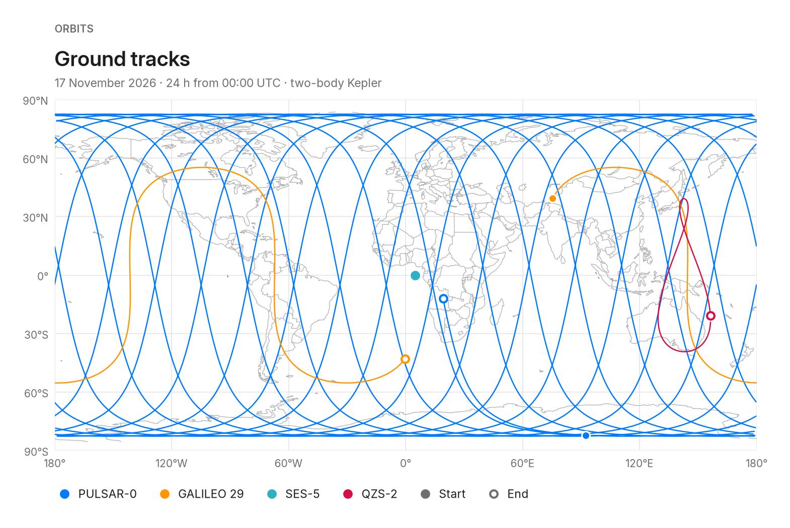
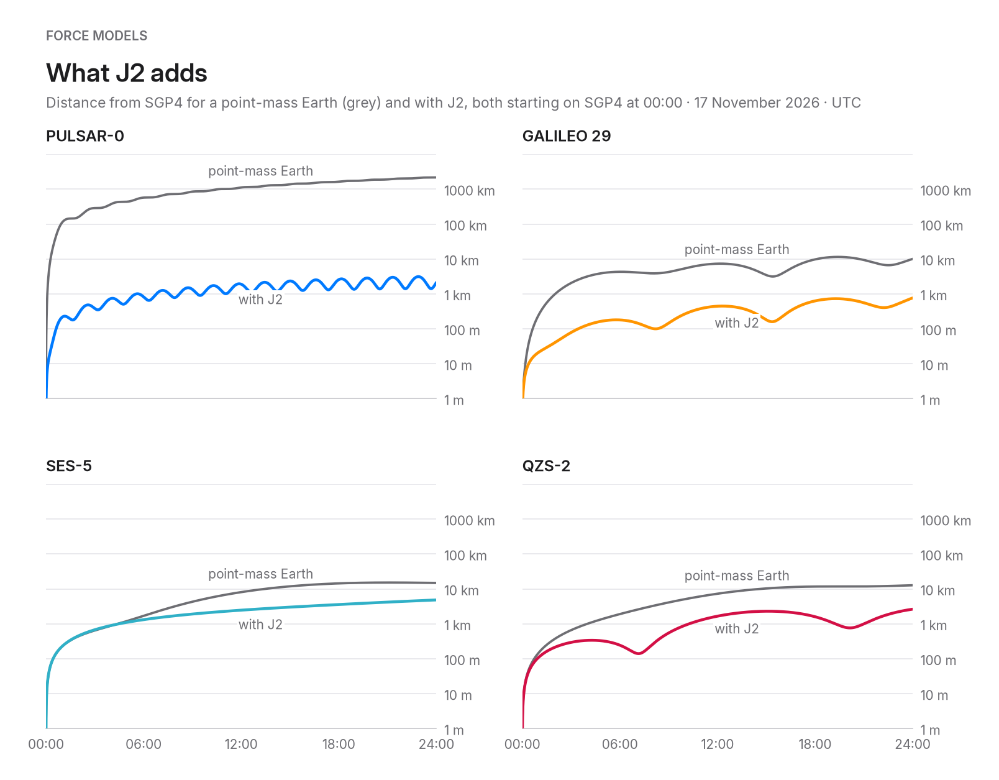
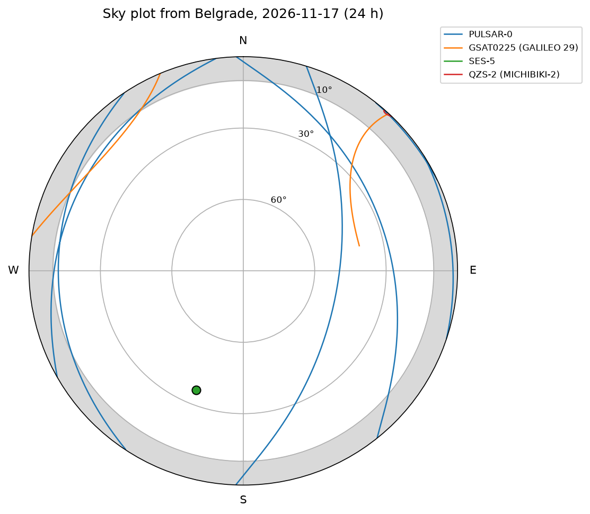
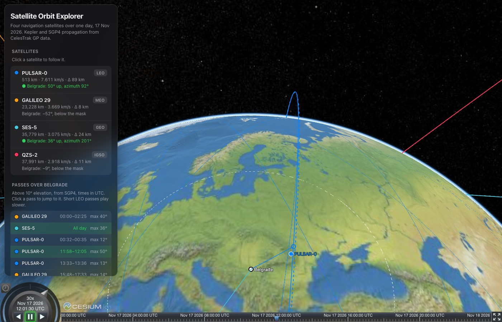

# Satellite Orbit Explorer

Keplerian orbit propagation and visualization of four real navigation satellites
(LEO, MEO, GEO and IGSO) from CelesTrak GP data, in Python.

**[Open the 3D viewer](https://devojka-od-papira.github.io/satellite-orbit-explorer/)**:
the four satellites on a globe, animated over the day, in the Earth-fixed or
inertial frame, with the Kepler and SGP4 positions side by side, and the day's
passes over a ground station (Belgrade, Tokyo, Sydney or Quito).

## What it does
- Reads GP (OMM) orbital elements and derives semi-major axis, period, perigee and apogee
- Propagates each orbit over one day at a 5 s step (Kepler's equation, Newton-Raphson)
- Transforms ECI positions to ECEF and to geodetic coordinates on WGS84
- Writes an orbit report, plots ground tracks and speed profiles, and exports KML for Google Earth
- Exports CZML for CesiumJS: animated satellites, ground tracks and inertial orbits,
  for both Kepler and SGP4
- Compares the two-body Kepler model with SGP4/SDP4 over the same day
- Integrates orbits numerically with Earth's oblateness (J2, RK4) and shows
  PULSAR-0's sun-synchronous plane drift
- Validates Kepler, SGP4 and J2 against precise SP3 orbits (GALILEO 29, QZS-2),
  with GPS time, UT1 and polar motion handled
- Adds the Moon and the Sun to the propagator and shows they are most of the
  remaining error
- Computes look angles and passes from a ground station, with a sky plot

## Data
`data/inputs/orbital_elements.json` holds the GP records and
`data/inputs/data_manifest.json` records where and when they were downloaded.
The propagation window starts at midnight UTC of the download day. To refresh
from CelesTrak:

    python -m orbit_explorer.fetch

This rewrites both files for the same four satellites, but only if every
download succeeds. It warns when an epoch is more than 3 days from the window
start. CelesTrak asks for no more than one download of the same data every two
hours, so it refuses to download again within 2 hours of the last download
(`--force` overrides).

A GitHub Actions workflow (`.github/workflows/refresh.yml`) does this every
day at 03:17 UTC. It runs the tests on the new data and opens a pull request,
or updates the open one, titled "Refresh GP data from CelesTrak (date)". The
PR description lists that day's Kepler vs SGP4 and two-body vs J2
differences and passes over Belgrade. Merging it publishes the 3D viewer for
the new day. The README figures and numbers stay at their documented date.
The workflow can also be started by hand from the Actions tab.

- **Needs a repository setting.** To let the workflow open PRs, turn on "Allow
  GitHub Actions to create and approve pull requests" under Settings → Actions
  → General.
- **Stale data is flagged.** If an element set is more than 3 days from the
  window start, the PR title ends in "stale elements" and the description
  starts with a warning.
- **Your commits are safe.** If the open refresh PR has commits that the
  workflow did not make, it skips that day and leaves a comment instead of
  force-pushing over them. Merge commits don't count. Once that PR is closed,
  the branch is replaced again. The push uses `--force-with-lease`, so a
  commit pushed during the run is never lost.
- **Rate limit.** It counts the download on an unmerged refresh branch too, so
  starting it by hand soon after the morning run does nothing.
- **Local preview.** `DRY_RUN=1 .github/scripts/daily_refresh.sh` previews the
  PR, then puts the data back.

### Precise orbits (SP3)
`data/inputs/precise/` keeps one day (2026-11-17, the day of the documented GP
data) of GFZ's rapid multi-GNSS precise orbits for GALILEO 29 (`E29`) and QZS-2
(`J02`): positions every 5 minutes, accurate to centimetres, in the
Earth-fixed IGc20 frame. `manifest.json` records the source. PULSAR-0 and
SES-5 have no public precise orbits. `orbit_explorer.sp3` reads SP3-c/d files,
writes subsets and interpolates between epochs:

- **Time scale:** SP3 epochs are in GPS time, 18 s ahead of UTC. Reading them
  as UTC puts GALILEO 29 about 50 km off, more than any model error here.
- **Interpolation:** a degree-10 Lagrange polynomial. Dropping every other
  epoch and interpolating it back recovers it to 3 mm (E29) and 8 mm (J02).
- **Matching:** SP3 files name satellites by PRN, not NORAD ID. `E29` and `J02`
  are each within a few km of our SGP4 positions and thousands of km from
  every other satellite in the file.

To make the subset from a downloaded file:

    python -m orbit_explorer.sp3 GBM0MGXRAP_20263210000_01D_05M_ORB.SP3.gz --keep E29 J02 -o data/inputs/precise/GBM0MGXRAP_20263210000_01D_05M_ORB_E29_J02.sp3

## Validation
All periods, perigee/apogee altitudes and speed ranges matched the GNSS Academy
workshop reference values for the four satellites. That dataset (downloaded
2026-11-10) is kept in `tests/data/`, and the period test runs against it,
because fresh elements change: QZS-2's period moves after station-keeping.

PULSAR-0 in low orbit is the fastest, at about 7.6 km/s. GALILEO 29 moves at
about 3.7 km/s and SES-5 at about 3.1 km/s. Their orbits are close to circular,
so their speed barely changes. QZS-2 has the same 24-hour period as SES-5, but
its orbit is eccentric (e ≈ 0.076), so its speed swings by about 0.5 km/s over
the day.

## Kepler vs SGP4
GP elements are meant for SGP4, which adds Earth's oblateness (J2–J4), drag and,
for high orbits, lunar and solar gravity. Comparing positions over the day
(GP data of 2026-11-17) shows what the two-body model leaves out:

- At each satellite's GP epoch the two models differ by 8–32 km. GP elements
  are SGP4 *mean* elements, not osculating Keplerian ones.
- **LEO (PULSAR-0)** drifts apart fastest: about 340 km by the end of the day,
  mostly in-track, plus a growing cross-track swing from the J2 nodal drift of
  its sun-synchronous orbit.
- **MEO, GEO and IGSO** stay within about 30–55 km all day.
- Element age matters as much as the model: with the earlier QZS-2 record,
  23 days old, the difference was about 200 km from the start of the day. With
  a fresh record it stays below 55 km.

## Earth's oblateness: a J2 propagator
`orbit_explorer.j2` integrates the equations of motion numerically (classic
fourth-order Runge-Kutta, 5 s step) with the point-mass gravity plus J2, the
largest term of the Earth's equatorial bulge. Two-body and J2 runs both start
from SGP4's position and velocity at 00:00, so the difference from SGP4 shows
only what each force model leaves out (GP data of 2026-11-17):

- **PULSAR-0 (LEO): J2 is almost everything.** A point-mass Earth is about
  2,200 km away from SGP4 after a day; with J2 it stays within about 3 km. The
  rest is drag and higher harmonics, and it is mostly in-track, i.e. timing.
- **Why a point mass started from the true state is even worse than Kepler
  from the GP elements** (about 340 km, above): the instantaneous orbit at
  00:00 includes J2's short-period wobble. Its semi-major axis is 12 km short of
  the mean one, so its period is 15 s too short, and that adds up every orbit.
  This is why GP elements are *mean* elements.
- **GALILEO 29, SES-5 and QZS-2:** J2 brings the error down from 10–15 km to
  1–5 km. Higher up, the Moon and the Sun matter more, and SDP4 includes them.
  J2 helps SES-5 (GEO) the least, and for GALILEO 29 and QZS-2 what is left is
  mostly cross-track: the Moon and the Sun tilt their orbital planes.
- **Constants.** The propagator uses WGS84, while SGP4 and the GP elements use
  the older WGS72. The summary also runs J2 with WGS72: the constants alone move
  the 24-hour result by up to about 1 km (PULSAR-0: 2.1 vs 3.3 km).
- **PULSAR-0 is sun-synchronous.** J2 turns its orbital plane eastward by
  +0.996° a day, within 0.1% of the first-order theory and 1% of the Sun's
  0.986° a day. Its plane keeps the same angle to the Sun all year, so it passes
  over each place at the same local time.

The tests check the physics, not just the numbers:
- the integrator against the exact circular orbit (under a metre a day);
- energy and the polar angular momentum, which J2 conserves (drift below 1e-10);
- the acceleration against the gradient of the J2 potential;
- the node drift against the secular theory for three satellites.

## Validation against precise orbits
`orbit_explorer.validation` compares every model with GFZ's precise orbits
(SP3, accurate to centimetres) for the two satellites that have them,
GALILEO 29 and QZS-2. It uses 2026-11-17, the day of the stored SP3 file, with
the GP elements of that same day (both in `data/inputs/precise/`).

| Distance from the precise orbit, RMS over the day | GALILEO 29 | QZS-2 |
|---|---|---|
| Kepler from the GP elements | 20.5 km | 36.1 km |
| SGP4 from the GP elements | **0.75 km** | **4.4 km** |
| J2 propagator from SGP4's state at 00:00 | 0.93 km | 4.8 km |
| J2 propagator from the precise state at 00:00 | 1.5 km | 3.3 km |
| J2 + Moon + Sun from the precise state at 00:00 | **0.14 km** | **0.36 km** |

- **SGP4 does what it was made for:** under a kilometre for GALILEO 29. Kepler
  reads its mean elements as osculating and is 20–50 km off.
- **J2 started on SGP4** inherits SGP4's starting error and adds no
  accuracy: up there the Moon and the Sun matter more than the bulge.
- **J2 started on the truth** leaves only the force model's error. It is
  within 100 m for the first hour, then drifts to 3–5 km by the end of the day,
  mostly in-track.
- **The Moon and the Sun are about 90% of that.** Adding them as point masses
  (`orbit_explorer.ephemeris`: the Sun from Meeus, the Moon from Montenbruck &
  Gill) cuts the error about ten times, to 0.14 km (GALILEO 29) and 0.36 km
  (QZS-2) RMS, better than SGP4. At Galileo's altitude the Moon pulls about
  2.5 times as hard as the Sun (5.8e-9 vs 2.3e-9 km/s²).
- **What is left is the size of solar radiation pressure.** An estimate, not
  a model: a Galileo satellite has about 0.02 m² of sunlit area per kg, so
  sunlight pushes it with about 1.2e-10 km/s², which unmodelled is worth up to
  about 0.4 km in a day. The J3 harmonic is at most about 5e-11 km/s² (up to
  0.17 km, and mostly periodic). The remaining 0.1–0.4 km RMS is likely mostly
  radiation pressure.
- **The ephemerides are checked against known events:** the 2026 equinoxes
  and solstices (Sun within 0.03°), and the full and new moons of January 2026
  (Moon within 0.3° of 180° and 0° from the Sun).
- **Frames and time.** SP3 positions are Earth-fixed (IGc20) and in GPS time.
  The comparison converts GPS time to UTC (18 s), rotates by sidereal time at
  UT1, and applies polar motion with the IERS values for the day
  (UT1−UTC = −0.072 s, pole at 0.12″, 0.33″). Leaving those out would move the
  result by 0.16 km (GALILEO 29) and 0.23 km (QZS-2). Reading GPS time as UTC
  would move it by about 50 km (GALILEO 29) and 25 km (QZS-2).

## Visibility from a ground station
`orbit_explorer.visibility` turns SGP4 positions into azimuth, elevation and
range for a station (Belgrade by default) and lists the passes above a 10°
elevation mask, with how far the Kepler model shifts each rise and set. From
Belgrade on 2026-11-17:

- **SES-5** sits still at 36° elevation, azimuth 201° (south, a little west),
  all day.
- **PULSAR-0** makes 4 passes above 10°, each 3–7 minutes long. Kepler gets
  rise and set wrong by up to about 40 s, growing over the day like its
  in-track error.
- **GALILEO 29** makes two long passes of about 2.5 and 1.7 hours.
- **QZS-2** never rises more than 1° above the horizon: QZSS is a regional
  system for Asia-Oceania (from Tokyo it climbs above 70°).

The same script works for the 3D viewer's other stations: `--station tokyo`,
`sydney` or `quito`. Their files get the station's name, e.g.
`outputs/visibility_tokyo_skyplot.png`, and your own station (`--lat`, `--lon`)
is marked custom (`visibility_custom-novi-sad.txt`), so no run overwrites
another. A satellite that never rises is faded in the sky plot's legend. From
Tokyo, QZS-2 traces its figure eight high in the southern sky and stays above
10° in one pass of about 19 hours:

## Run it
    pip install -e .
    python -m orbit_explorer.report
    python -m orbit_explorer.plots
    python -m orbit_explorer.kml
    python -m orbit_explorer.czml
    python -m orbit_explorer.sgp4_compare
    python -m orbit_explorer.j2
    python -m orbit_explorer.validation
    python -m orbit_explorer.visibility    # Belgrade
    python -m orbit_explorer.visibility --station tokyo    # or sydney, quito
    python -m orbit_explorer.visibility --name "Novi Sad" --lat 45.25 --lon 19.84 --height 80

## 3D viewer
A static CesiumJS page in `web/` that loads `orbits.czml`. Its interface
follows Apple's dark design, to match the figures: the system font (Inter
elsewhere), translucent panels, grouped lists, segmented controls and switches.
It also shows a ground station: Belgrade, Tokyo, Sydney or Quito. A link
ending in `#tokyo`, `#sydney` or `#quito` opens on that station. Tokyo shows
why QZSS is a regional system: QZS-2, never above Belgrade's horizon, stays
above 10° there in one pass of about 19 hours. For the chosen station the viewer shows:
- each satellite's live elevation and azimuth;
- the day's passes, where a click jumps to that pass (short LEO passes play
  at 30× so you can watch them);
- a line from the station to each satellite while it is above the mask;
- for PULSAR-0, a dashed circle on the ground: while its track is inside, the
  satellite is above 10° from the station.

GitHub Actions
builds and publishes it to GitHub Pages on every push to `main`. To preview it
locally:

    python -m orbit_explorer.czml
    mkdir -p _site && cp -R web/. _site/ && cp outputs/orbits.czml _site/
    python -m http.server 8000 -d _site    # then open http://localhost:8000

## Style
All figures share one look, set in `orbit_explorer.style` after Apple's chart
design: Apple system colours, light gridlines, no frames, and a left-aligned
header. Each satellite keeps its colour in every figure, in Google Earth and
in the 3D viewer. The four colours stay distinguishable with colour blindness.
The typeface is [Inter](https://github.com/rsms/inter), bundled under the SIL
Open Font License. Apple's SF Pro may only be used for Apple-platform UI.

## Development
    pip install -e ".[dev]"
    pre-commit install
    pytest

Most tests run on the current GP data, which the daily refresh replaces, so
they only check what must hold for any day's data. Tests about what one day
shows (how much J2 helps each satellite, agreement with that day's precise
orbits) use a frozen copy of the 2026-11-17 data in `data/inputs/precise/`, so
a new day can't break them.

The 3D viewer has its own tests in `tests/viewer`. They build the site,
open it in headless Chromium with Playwright, and check the panel, the station
picker, the passes and the live look angles against the Python results. CI
runs them in a separate job. Locally:

    pip install -e ".[viewer]"
    playwright install chromium    # or skip it to use an installed Google Chrome
    pytest tests/viewer

Without Playwright, `pytest` skips them.

Built during GNSS Academy's Space Career Week 2026.
