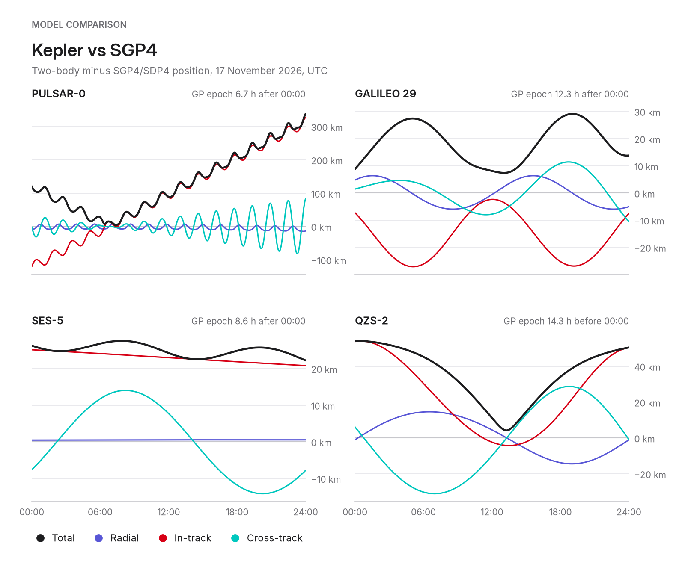

# Satellite Orbit Explorer

Keplerian orbit propagation and visualization of four real navigation satellites
(LEO, MEO, GEO and IGSO) from CelesTrak GP data, in Python.

**[Open the 3D viewer](https://devojka-od-papira.github.io/satellite-orbit-explorer/)**:
the four satellites on a globe, animated over the day, in the Earth-fixed or
inertial frame, with the Kepler and SGP4 positions side by side, and the day's
passes over a ground station (Belgrade, Tokyo, Sydney or Quito).

## What it does
- Reads GP (OMM) orbital elements and derives semi-major axis, period, perigee and apogee
- Propagates each orbit over one day at a 5 s step (Kepler's equation, Newton-Raphson)
- Transforms ECI positions to ECEF and to geodetic coordinates on WGS84
- Writes an orbit report, plots ground tracks and speed profiles, and exports KML for Google Earth
- Exports CZML for CesiumJS: animated satellites, ground tracks and inertial orbits,
  for both Kepler and SGP4
- Compares the two-body Kepler model with SGP4/SDP4 over the same day
- Computes look angles and passes from a ground station, with a sky plot

## Data
`data/inputs/orbital_elements.json` holds the GP records and
`data/inputs/data_manifest.json` records where and when they were downloaded.
The propagation window starts at midnight UTC of the download day. To refresh
from CelesTrak:

    python -m orbit_explorer.fetch

This rewrites both files for the same four satellites, but only if every
download succeeds. It warns when an epoch is more than 3 days from the window
start. CelesTrak asks for no more than one download of the same data every two
hours, so it refuses to download again within 2 hours of the last download
(`--force` overrides).

A GitHub Actions workflow (`.github/workflows/refresh.yml`) does this every
day at 03:17 UTC. It runs the tests on the new data and opens a pull request,
or updates the open one, titled "Refresh GP data from CelesTrak (date)". The
PR description lists that day's Kepler vs SGP4 differences and passes over
Belgrade. Merging it publishes the 3D viewer for the new day. The README
figures and numbers stay at their documented date. The workflow can also be
started by hand from the Actions tab.

- **Needs a repository setting.** To let the workflow open PRs, turn on "Allow
  GitHub Actions to create and approve pull requests" under Settings → Actions
  → General.
- **Stale data is flagged.** If an element set is more than 3 days from the
  window start, the PR title ends in "stale elements" and the description
  starts with a warning.
- **Your commits are safe.** If the open refresh PR has commits that the
  workflow did not make, it skips that day and leaves a comment instead of
  force-pushing over them. Merge commits don't count. Once that PR is closed,
  the branch is replaced again. The push uses `--force-with-lease`, so a
  commit pushed during the run is never lost.
- **Rate limit.** It counts the download on an unmerged refresh branch too, so
  starting it by hand soon after the morning run does nothing.
- **Local preview.** `DRY_RUN=1 .github/scripts/daily_refresh.sh` previews the
  PR, then puts the data back.

## Validation
All periods, perigee/apogee altitudes and speed ranges matched the GNSS Academy
workshop reference values for the four satellites. That dataset (downloaded
2026-11-10) is kept in `tests/data/`, and the period test runs against it,
because fresh elements change: QZS-2's period moves after station-keeping.

PULSAR-0 in low orbit is the fastest, at about 7.6 km/s. GALILEO 29 moves at
about 3.7 km/s and SES-5 at about 3.1 km/s. Their orbits are close to circular,
so their speed barely changes. QZS-2 has the same 24-hour period as SES-5, but
its orbit is eccentric (e ≈ 0.076), so its speed swings by about 0.5 km/s over
the day.

## Kepler vs SGP4
GP elements are meant for SGP4, which adds Earth's oblateness (J2–J4), drag and,
for high orbits, lunar and solar gravity. Comparing positions over the day
(GP data of 2026-11-17) shows what the two-body model leaves out:

- At each satellite's GP epoch the two models differ by 8–32 km. GP elements
  are SGP4 *mean* elements, not osculating Keplerian ones.
- **LEO (PULSAR-0)** drifts apart fastest: about 340 km by the end of the day,
  mostly in-track, plus a growing cross-track swing from the J2 nodal drift of
  its sun-synchronous orbit.
- **MEO, GEO and IGSO** stay within about 30–55 km all day.
- Element age matters as much as the model: with the earlier QZS-2 record,
  23 days old, the difference was about 200 km from the start of the day. With
  a fresh record it stays below 55 km.

## Visibility from a ground station
`orbit_explorer.visibility` turns SGP4 positions into azimuth, elevation and
range for a station (Belgrade by default) and lists the passes above a 10°
elevation mask, with how far the Kepler model shifts each rise and set. From
Belgrade on 2026-11-17:

- **SES-5** sits still at 36° elevation, azimuth 201° (south, a little west),
  all day.
- **PULSAR-0** makes 4 passes above 10°, each 3–7 minutes long. Kepler gets
  rise and set wrong by up to about 40 s, growing over the day like its
  in-track error.
- **GALILEO 29** makes two long passes of about 2.5 and 1.7 hours.
- **QZS-2** never rises more than 1° above the horizon: QZSS is a regional
  system for Asia-Oceania (from Tokyo it climbs above 70°).

The same script works for the 3D viewer's other stations: `--station tokyo`,
`sydney` or `quito`. Their files get the station's name, e.g.
`outputs/visibility_tokyo_skyplot.png`, so Belgrade's are never overwritten.
From Tokyo, QZS-2 traces its figure eight high in the southern sky and stays
above 10° for about 19 hours:

## Run it
    pip install -e .
    python -m orbit_explorer.report
    python -m orbit_explorer.plots
    python -m orbit_explorer.kml
    python -m orbit_explorer.czml
    python -m orbit_explorer.sgp4_compare
    python -m orbit_explorer.visibility    # Belgrade
    python -m orbit_explorer.visibility --station tokyo    # or sydney, quito
    python -m orbit_explorer.visibility --name "Novi Sad" --lat 45.25 --lon 19.84 --height 80

## 3D viewer
A static CesiumJS page in `web/` that loads `orbits.czml`. Its interface
follows Apple's dark design, to match the figures: the system font (Inter
elsewhere), translucent panels, grouped lists, segmented controls and switches.
It also shows a ground station: Belgrade, Tokyo, Sydney or Quito. A link
ending in `#tokyo`, `#sydney` or `#quito` opens on that station. Tokyo shows
why QZSS is a regional system: QZS-2, never above Belgrade's horizon, stays
above 10° there for about 19 hours. For the chosen station the viewer shows:
- each satellite's live elevation and azimuth;
- the day's passes, where a click jumps to that pass (short LEO passes play
  at 30× so you can watch them);
- a line from the station to each satellite while it is above the mask;
- for PULSAR-0, a dashed circle on the ground: while its track is inside, the
  satellite is above 10° from the station.

GitHub Actions
builds and publishes it to GitHub Pages on every push to `main`. To preview it
locally:

    python -m orbit_explorer.czml
    mkdir -p _site && cp -R web/. _site/ && cp outputs/orbits.czml _site/
    python -m http.server 8000 -d _site    # then open http://localhost:8000

## Style
All figures share one look, set in `orbit_explorer.style` after Apple's chart
design: Apple system colours, light gridlines, no frames, and a left-aligned
header. Each satellite keeps its colour in every figure, in Google Earth and
in the 3D viewer. The four colours stay distinguishable with colour blindness.
The typeface is [Inter](https://github.com/rsms/inter), bundled under the SIL
Open Font License. Apple's SF Pro may only be used for Apple-platform UI.

## Development
    pip install -e ".[dev]"
    pre-commit install
    pytest

The 3D viewer has its own tests in `tests/viewer`. They build the site,
open it in headless Chromium with Playwright, and check the panel, the station
picker, the passes and the live look angles against the Python results. CI
runs them in a separate job. Locally:

    pip install -e ".[viewer]"
    playwright install chromium    # or skip it to use an installed Google Chrome
    pytest tests/viewer

Without Playwright, `pytest` skips them.

Built during GNSS Academy's Space Career Week 2026.
