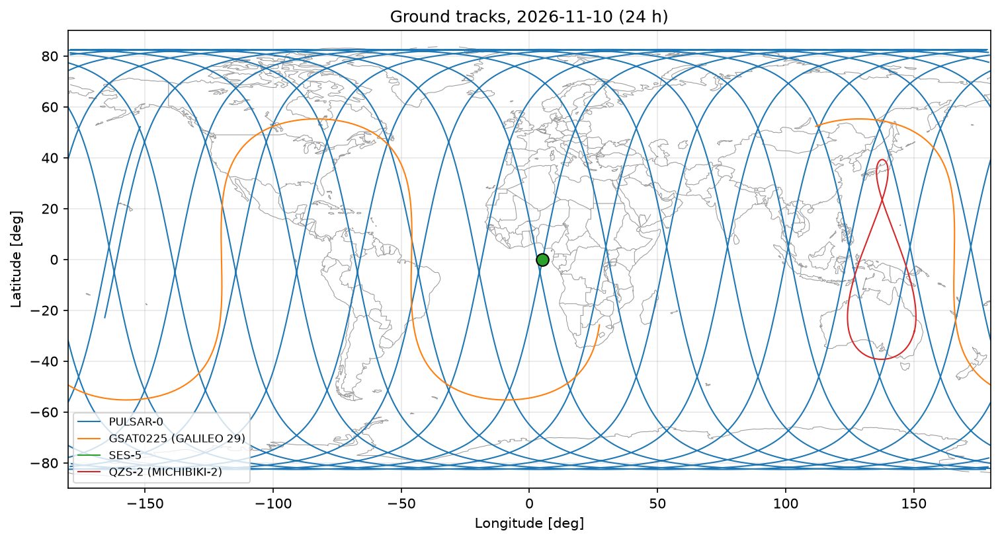

# Satellite Orbit Explorer

Keplerian orbit propagation and visualization of four real navigation satellites
(LEO, MEO, GEO and IGSO) from CelesTrak GP data, in Python.

## What it does
- Reads GP (OMM) orbital elements and derives semi-major axis, period, perigee and apogee
- Propagates each orbit over one day at a 5 s step (Kepler's equation, Newton-Raphson)
- Transforms ECI positions to ECEF and to geodetic coordinates on WGS84
- Writes an orbit report, plots ground tracks and speed profiles, and exports KML for Google Earth

## Validation
All periods, perigee/apogee altitudes and speed ranges match the GNSS Academy
workshop reference values for the four satellites.

## Run it
    pip install -e .
    python -m orbit_explorer.report
    python -m orbit_explorer.plots
    python -m orbit_explorer.kml

Built during GNSS Academy's Space Career Week 2026. Work in progress: tests,
an SGP4 comparison and a 3D web viewer are next.
